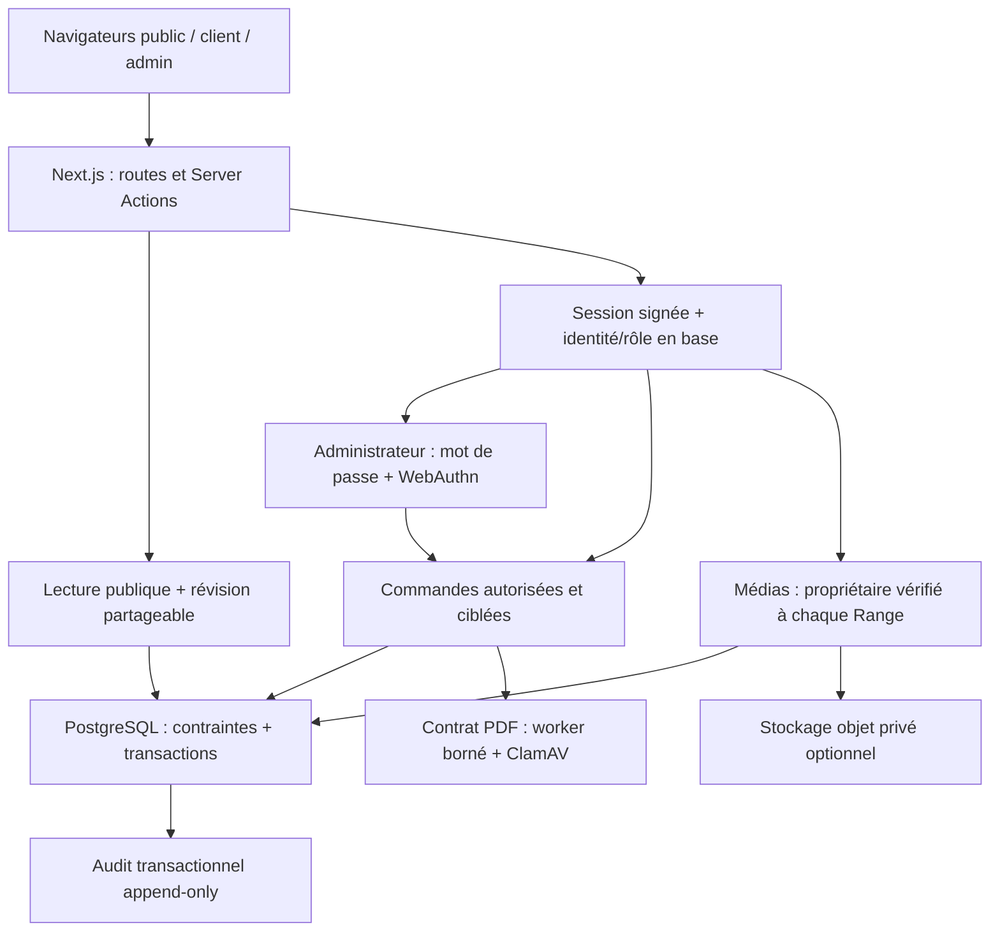

# Architecture et frontières de confiance

Les migrations s’exécutent séparément avec un compte propriétaire. Le compte de l’application ne crée/altère pas de tables ; il vérifie le schéma et ses contraintes. Les affectations normalisées sont synchronisées transactionnellement par trigger ; leurs modifications directes sont retirées au rôle runtime.

Les messages et demandes web ne chargent pas le CRM complet. Les paiements chargent un client et ses biens. Les autres snapshots utilisent des contrôles de concurrence par ligne ; certaines listes et écritures de catalogue restent à paginer/extraire. Les révisions sont des notifications, pas une autorité d’authentification ou de solde financier.

Le cache partagé s’applique uniquement au signal public de révision. Les réponses client, sessions et fichiers privés restent sans cache partagé. La session administrateur ne peut être prolongée par les sondages en arrière-plan.

Les originaux techniques appartiennent à une archive privée avec checksums. Le site ne publie que les présentations approuvées ; le build n’a pas besoin des masters. Le retrait au HEAD ne retire pas les anciens fichiers des clones ou de l’historique GitHub. Les frontières réelles proxy/TLS/WAF/bucket et les sauvegardes doivent être attestées par l’exploitant.
